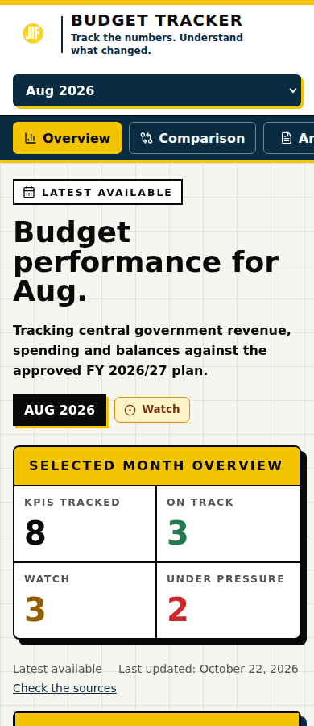
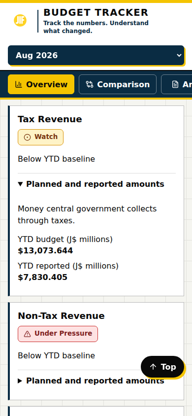

# Tracker UI fixes — verification, October 27, 2026

Scope: ordinary monthly tracker. Preserve financial data, classifications, frozen receipts, capture presentation, private workflows, and Spending Explorer. No production deployment or real subscription submission.

## Changes and evidence

- Month selection uses history entries; Back/Forward reloads the requested month. A request sequence guard prevents slower earlier responses replacing the newest selection. Errors clear stale data and retry the URL month.
- Comparisons render every movement. April's smaller-surplus wording and June's opening headline correction are guarded; revised source copy wins. Selected/historical periods and month labels are explicit.
- Source publisher and August publication date are bound to known official workbook URLs. August receipts page 2 documents September 30, 2026 and the YTD calculation; May receipts pages 2–3 document the Capital Expenditure standing rule approved July 31. Earlier official publication dates and the overall aggregation formula remain undisclosed, not inferred.
- Public overview is compact, with a smaller heading, inline publication information and expandable summary. Mobile KPI disclosures retain exact amounts. Capture keeps its original LatestUpdateStatus card and receives no new review note. Amber contrast change is scoped to tracker-main.
- Subscription CTA targets the form, validation focuses invalid fields, and a persistent live region announces progress and results.

## Executed checks

`npm test`: 58 passed; zero failed, skipped or cancelled. `npm run build`: passed. `git diff --check`: passed.

`scripts/verify-tracker-ui.mjs` in local headless Chromium: PASS. Five month selections, Back/Forward, rapid selection with delayed earlier responses, April wording, historical labels, all seven unchanged August indicators, no document overflow at 320/390/768/1440, mobile exact-value disclosure, form focus/invalid-email semantics, and three mocked subscription responses (pending confirmation, already subscribed, server error). Zero browser page errors and zero real subscription requests.

All browser feed values are synthetic regression fixtures. Screenshots below are layout evidence, not financial evidence. External font requests were blocked, so screenshots use fallback fonts; loaded brand-font rendering, live-feed reconciliation, full WCAG audit, actual subscription delivery and performance benchmarks are outside this verification. No new runtime dependency was added. Browser dependencies were installed outside the project.

## Reproduce

Start Vite with `VITE_TRACKER_SUBSCRIBE_WEBHOOK_URL=http://127.0.0.1:5173/__mock_subscribe npm run dev -- --host 127.0.0.1`.
Run `node scripts/verify-tracker-ui.mjs` with Playwright available. Optional `PLAYWRIGHT_MODULE`, `CHROMIUM_PATH`, `TEST_BASE_URL`, and `TEST_OUTPUT_DIR` override local paths. The script blocks external requests and intercepts the mocked subscription endpoint.

## Release and rollback

Branch/PR only. Merge and deployment require separate owner authorization. Revert this focused PR to roll back; no data or workflow reconciliation is necessary. After approval and deployment, check the latest and historical months against the live feed, verify brand fonts and repeat keyboard/mobile checks.
